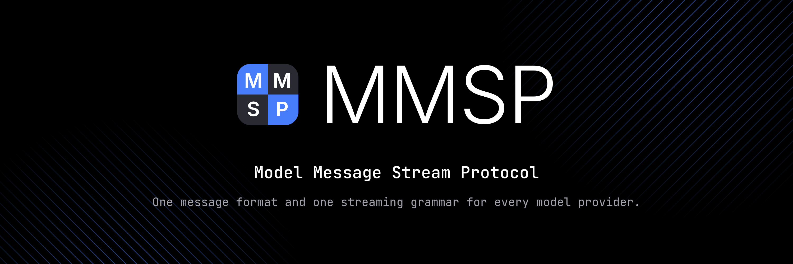
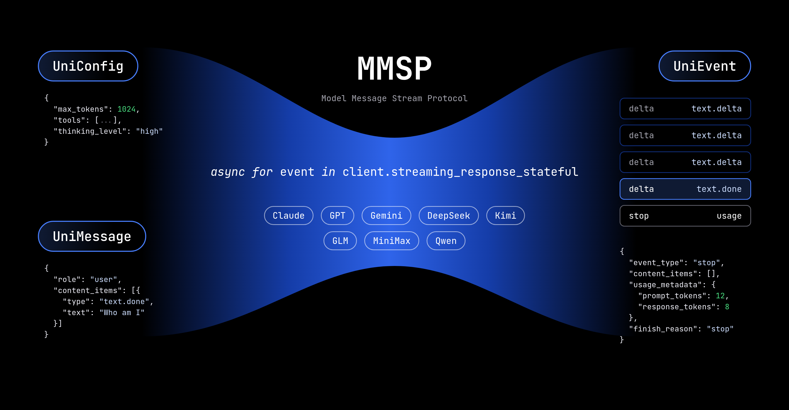
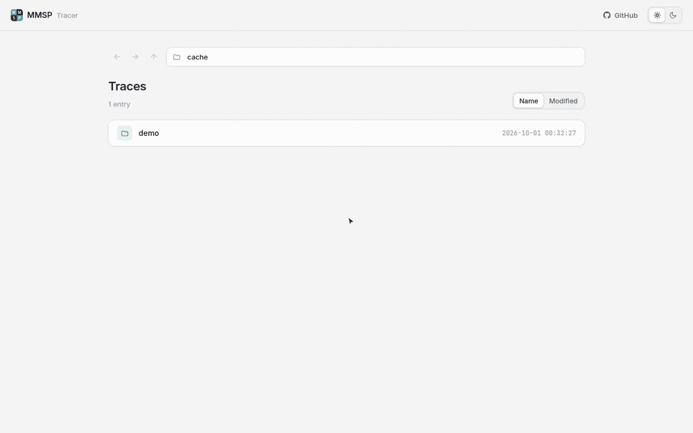
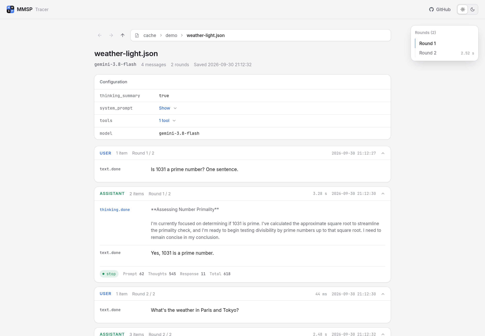
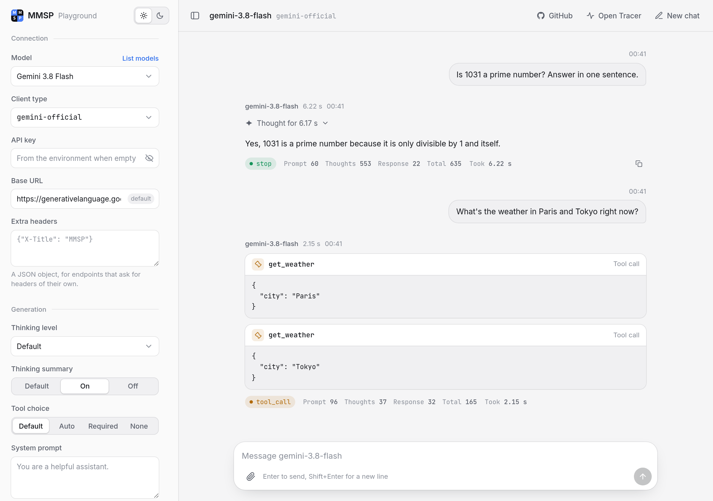

# MMSP - Model Message Stream Protocol

[](https://github.com/Prism-Shadow/model-message-stream-protocol/stargazers)
[](https://github.com/Prism-Shadow/model-message-stream-protocol/commits/main)
[](https://github.com/Prism-Shadow/model-message-stream-protocol/graphs/contributors)
[](https://github.com/Prism-Shadow/model-message-stream-protocol/actions/workflows/ci.yml)
[](https://pypi.org/project/mmsp/)
[](https://www.npmjs.com/package/@prismshadow/mmsp)

[English](README.md) | 简体中文

**用同一种方式接入所有模型，无需为每个厂商记住一套不同的 API。**

MMSP（Model Message Stream Protocol，模型消息流协议）为所有模型提供商统一了消息格式与流式语法，同时提供行为一致的 Python 与 TypeScript SDK，减轻开发者的心智负担。

📖 文档：[mmsp.penguin.ooo/zh](https://mmsp.penguin.ooo/zh/)

设计规范：MMSP 遵循的规范及变更协议或公开 API 的决定均以独立 RFC 存放在 [`design/`](design/README.zh.md) 中。

正在使用编码 Agent？可安装 [`skills/`](skills/) 目录下的 MMSP SKILL 文件，让编码助手生成正确的 MMSP 调用代码。

📢 关注 [](https://x.com/code_hiyouga) 或加入 [](https://discord.gg/eFHKqqcU3D)

## 为什么选择 MMSP？

- 🔗 **统一（Unified）**：提供一致、直观的接口，跨不同大模型开发 **Agent**。

- 🎯 **精准（Precise）**：在多步工具调用中自动处理**[交错思考（interleaved thinking）](https://platform.claude.com/docs/en/build-with-claude/extended-thinking#interleaved-thinking)**，避免模型性能退化。

- 🧭 **可追踪（Traceable）**：提供轻量但细粒度的执行**追踪（tracing）**，便于调试和审计大模型调用。

## 核心特性

### AutoLLMClient（Python & TypeScript）

**零代码改动**、**无性能损失**地切换不同大模型。



### 内置可观测性

只需添加**一个 `trace_id` 参数**即可审计模型调用，无需额外部署数据库。



## 支持的模型

以下为我们重点支持的模型家族。完整的模型变体、提供商与价格请查看[模型索引](https://mmsp.penguin.ooo/zh/models/)或调用 `list_supported_models()`。

| 模型名称          | 提供商                                                                   | 示例模型 ID          | 输入模态    | 输出模态                       |
| ----------------- | ------------------------------------------------------------------------ | -------------------- | ----------- | ------------------------------ |
| Gemini 3-4        | Official, Google Vertex AI, OpenRouter, OpenCode Go, Penguin Go          | `gemini-4-carbon`    | Text, Image | Text, Image, Speech, Embedding |
| Claude 4.5-5.5    | Official, Amazon Bedrock, OpenRouter, OpenCode Go                        | `claude-opus-5-5`    | Text, Image | Text                           |
| GPT-5.3-6.2       | Official, OpenRouter, OpenCode Go                                        | `gpt-6.2-sol`        | Text, Image | Text, Embedding                |
| DeepSeek V3.2/V4  | Official, OpenRouter, SiliconFlow, TokenDance, OpenCode Go, Penguin Go, vLLM | `deepseek-flash` | Text, Image | Text                           |
| Kimi-K2.5-K3.1    | Official, OpenRouter, SiliconFlow, TokenDance, OpenCode Go               | `kimi-k3.1-pro`      | Text, Image | Text                           |
| GLM-4.5-5.3       | Official, OpenRouter, SiliconFlow, TokenDance, OpenCode Go               | `glm-5.3`            | Text, Image | Text                           |
| MiniMax-M2.5-M3.1 | Official, OpenRouter, TokenDance, OpenCode Go                            | `MiniMax-M3.1-Flash` | Text, Image | Text                           |
| Qwen3-4           | DashScope, Qwen Token Plan, OpenRouter, SiliconFlow, TokenDance, OpenCode Go, vLLM | `qwen4-max` | Text, Image | Text, Embedding                |
| Grok 4.3-4.7      | OpenRouter, OpenCode Go                                                  | `x-ai/grok-4.7`      | Text, Image | Text                           |
| Hy3/Hy4           | OpenRouter, SiliconFlow, TokenDance, OpenCode Go                         | `hy4`                | Text, Image | Text                           |
| MiMo-V2.5/V2.6    | OpenRouter, TokenDance, OpenCode Go                                      | `mimo-v2.6-pro`      | Text, Image | Text                           |

同时也支持自定义兼容协议端点，覆盖 1000+ 在线与本地模型。

### 客户端

`AutoLLMClient` 接收模型 ID 和可选的 `client_type`。**官方客户端**直接对接厂商原生 API 并从环境变量读取对应密钥；**兼容客户端**按统一线路协议对接任何支持该协议的端点。

| `client_type`              | 协议说明                                                                 | 密钥与端点环境变量                        |
| -------------------------- | ------------------------------------------------------------------------ | ----------------------------------------- |
| `openai-official`          | OpenAI Responses 与 Embeddings                                           | `OPENAI_API_KEY`, `OPENAI_BASE_URL`       |
| `anthropic-official`       | Anthropic Messages                                                       | `ANTHROPIC_API_KEY`, `ANTHROPIC_BASE_URL` |
| `google-official`          | Gemini Interactions                                                      | `GEMINI_API_KEY`, `GEMINI_BASE_URL`       |
| `deepseek-official`        | DeepSeek Responses                                                       | `DEEPSEEK_API_KEY`, `DEEPSEEK_BASE_URL`   |
| `moonshot-official`        | Moonshot Chat Completions                                                | `MOONSHOT_API_KEY`, `MOONSHOT_BASE_URL`   |
| `zai-official`             | Z.AI Chat Completions                                                    | `ZAI_API_KEY`, `ZAI_BASE_URL`             |
| `minimax-official`         | MiniMax Responses                                                        | `MINIMAX_API_KEY`, `MINIMAX_BASE_URL`     |
| `openai-responses`         | OpenAI Responses（OpenAI、OpenRouter、DeepSeek、Z.AI、MiniMax）          | `OPENAI_API_KEY`, `OPENAI_BASE_URL`       |
| `openai-chat` (`openai`)   | OpenAI Chat Completions（主流网关、SiliconFlow、vLLM）                   | `OPENAI_API_KEY`, `OPENAI_BASE_URL`       |
| `openai-chat-vllm-adapter` | vLLM Chat Completions，自动将 `thinking_level` 映射至模板开关             | `VLLM_API_KEY`, `VLLM_BASE_URL`           |
| `openai-embedding`         | OpenAI Embeddings                                                        | `OPENAI_API_KEY`, `OPENAI_BASE_URL`       |
| `ant-messages`             | Anthropic Messages（Anthropic、OpenRouter、DeepSeek、Z.AI、MiniMax）     | `ANTHROPIC_API_KEY`, `ANTHROPIC_BASE_URL` |
| `google-genai`             | Google generateContent（Vertex AI、Gemini API、兼容网关）                | `GEMINI_API_KEY`, `GEMINI_BASE_URL`       |
| `mmsp`                     | MMSP 流协议（对接 [MMSP Server](#mmsp-server)）                          | `MMSP_API_KEY`, `MMSP_BASE_URL`           |

当模型 ID 以已知家族前缀开头（`gpt-`、`text-embedding-`、`claude-`、`gemini-`、`deepseek-`、`kimi-`、`glm-`、`minimax-`、`jina-`）时，可省略 `client_type`；其他模型 ID 必须指定。图像生成、语音合成、语音识别、网页搜索/抓取等客户端，以及 Vertex AI、Amazon Bedrock 与各网关的配置详见[模型与端点](https://mmsp.penguin.ooo/zh/docs/models/)。

在代码中查询内置模型注册表：

```python
from mmsp import list_supported_models

models = list_supported_models(currency="CNY")  # 默认为 "USD"
```

```typescript
import { listSupportedModels } from "@prismshadow/mmsp";

const models = listSupportedModels("CNY"); // 默认为 "USD"
```

## 安装

### Python 包

从 PyPI 安装：

```bash
uv add mmsp
# 或
pip install mmsp
```

从源码构建：

```bash
cd src_py && make
```

更多用法示例与 API 文档请参考 [src_py/README.md](src_py/README.md)。

### TypeScript 包

从 npm 安装：

```bash
npm install @prismshadow/mmsp
```

从源码构建：

```bash
cd src_ts && make install && make build
```

更多用法示例与 API 文档请参考 [src_ts/README.md](src_ts/README.md)。

## Agent Skills

MMSP 提供适用于 Codex / Claude Code 的 Skill 文件，帮助编码助手正确调用 SDK：

- Python skill：[`skills/mmsp-python/SKILL.md`](skills/mmsp-python/SKILL.md)
- TypeScript skill：[`skills/mmsp-typescript/SKILL.md`](skills/mmsp-typescript/SKILL.md)

## API 概览

`AutoLLMClient` 是与 MMSP SDK 交互的核心类，接收 `model` 以及可选的 `client_type`、`api_key`、`base_url` 和 `default_headers`（详见[客户端 API](https://mmsp.penguin.ooo/zh/docs/client/)）：

- `(async) streaming_response(messages, config)`：以无状态方式流式获取模型响应。
- `(async) streaming_response_stateful(message, config)`：以有状态方式流式获取模型响应并自动维护对话历史。
- `(async) list_models()`：列出当前端点支持的模型 ID。
- `clear_history()`：清空有状态客户端的对话历史。
- `get_history()`：获取有状态客户端的对话历史副本。
- `set_history(history)`：用给定列表的副本替换有状态客户端的对话历史。

两个流式方法都会依次产出每次携带一个内容项的 `delta` 事件，最后以单个携带用量与结束原因的 `stop` 事件收尾（见 [UniEvent](#unievent)）。

## 基础用法

> [!NOTE]
> 调用 MMSP SDK 时推荐使用**有状态接口（stateful interface）**。

### OpenAI GPT-5.6

Python 示例：

```python
import asyncio
import os
from mmsp import AutoLLMClient

os.environ["OPENAI_API_KEY"] = "your-openai-api-key"

async def main():
    client = AutoLLMClient(model="gpt-5.6-sol")
    async for event in client.streaming_response_stateful(
        message={
            "role": "user",
            "content_items": [{"type": "text.done", "text": "Say 'Hello, World!'"}]
        },
        config={"temperature": 1.0}
    ):
        print(event)

asyncio.run(main())
# {'role': 'assistant', 'event_type': 'delta', 'content_items': [{'type': 'text.delta', 'text': 'Hello'}], 'usage_metadata': None, 'finish_reason': None}
# {'role': 'assistant', 'event_type': 'delta', 'content_items': [{'type': 'text.delta', 'text': ','}], 'usage_metadata': None, 'finish_reason': None}
# {'role': 'assistant', 'event_type': 'delta', 'content_items': [{'type': 'text.delta', 'text': ' World'}], 'usage_metadata': None, 'finish_reason': None}
# {'role': 'assistant', 'event_type': 'delta', 'content_items': [{'type': 'text.delta', 'text': '!'}], 'usage_metadata': None, 'finish_reason': None}
# {'role': 'assistant', 'event_type': 'delta', 'content_items': [{'type': 'text.done', 'text': 'Hello, World!'}], 'usage_metadata': None, 'finish_reason': None}
# {'role': 'assistant', 'event_type': 'stop', 'content_items': [], 'usage_metadata': {'cached_tokens': 0, 'prompt_tokens': 12, 'thoughts_tokens': 0, 'response_tokens': 8}, 'finish_reason': 'stop'}
```

TypeScript 示例：

```typescript
import { AutoLLMClient } from "@prismshadow/mmsp";

process.env.OPENAI_API_KEY = "your-openai-api-key";

async function main() {
  const client = new AutoLLMClient({ model: "gpt-5.6-sol" });
  for await (const event of client.streamingResponseStateful({
    message: {
      role: "user",
      content_items: [{ type: "text.done", text: "Say 'Hello, World!'" }]
    },
    config: {}
  })) {
    console.log(event);
  }
}

main().catch(console.error);
// {'role': 'assistant', 'event_type': 'delta', 'content_items': [{'type': 'text.delta', 'text': 'Hello'}], 'usage_metadata': null, 'finish_reason': null}
// {'role': 'assistant', 'event_type': 'delta', 'content_items': [{'type': 'text.delta', 'text': ','}], 'usage_metadata': null, 'finish_reason': null}
// {'role': 'assistant', 'event_type': 'delta', 'content_items': [{'type': 'text.delta', 'text': ' World'}], 'usage_metadata': null, 'finish_reason': null}
// {'role': 'assistant', 'event_type': 'delta', 'content_items': [{'type': 'text.delta', 'text': '!'}], 'usage_metadata': null, 'finish_reason': null}
// {'role': 'assistant', 'event_type': 'delta', 'content_items': [{'type': 'text.done', 'text': 'Hello, World!'}], 'usage_metadata': null, 'finish_reason': null}
// {'role': 'assistant', 'event_type': 'stop', 'content_items': [], 'usage_metadata': {'cached_tokens': 0, 'prompt_tokens': 12, 'thoughts_tokens': 0, 'response_tokens': 8}, 'finish_reason': 'stop'}
```

### Anthropic Claude Opus 5

<details><summary><strong>Python 示例</strong></summary>

```python
import asyncio
import os
from mmsp import AutoLLMClient

os.environ["ANTHROPIC_API_KEY"] = "your-anthropic-api-key"

async def main():
    client = AutoLLMClient(model="claude-opus-5")
    async for event in client.streaming_response_stateful(
        message={
            "role": "user",
            "content_items": [{"type": "text.done", "text": "Say 'Hello, World!'"}]
        },
        config={}
    ):
        print(event)

asyncio.run(main())
```

</details>

<details><summary><strong>TypeScript 示例</strong></summary>

```typescript
import { AutoLLMClient } from "@prismshadow/mmsp";

process.env.ANTHROPIC_API_KEY = "your-anthropic-api-key";

async function main() {
  const client = new AutoLLMClient({ model: "claude-opus-5" });
  for await (const event of client.streamingResponseStateful({
    message: {
      role: "user",
      content_items: [{"type": "text.done", "text": "Say 'Hello, World!'"}]
    },
    config: {}
  })) {
    console.log(event);
  }
}

main().catch(console.error);
```

</details>

### OpenRouter GLM-5.3

<details><summary><strong>Python 示例</strong></summary>

```python
import asyncio
import os
from mmsp import AutoLLMClient

os.environ["ZAI_API_KEY"] = "your-openrouter-api-key"
os.environ["ZAI_BASE_URL"] = "https://openrouter.ai/api/v1"

async def main():
    client = AutoLLMClient(model="z-ai/glm-5.3", client_type="zai-official")
    async for event in client.streaming_response_stateful(
        message={
            "role": "user",
            "content_items": [{"type": "text.done", "text": "Say 'Hello, World!'"}]
        },
        config={}
    ):
        print(event)

asyncio.run(main())
```

</details>
<details><summary><strong>TypeScript 示例</strong></summary>

```typescript
import { AutoLLMClient } from "@prismshadow/mmsp";

process.env.ZAI_API_KEY = "your-openrouter-api-key";
process.env.ZAI_BASE_URL = "https://openrouter.ai/api/v1";

async function main() {
  const client = new AutoLLMClient({ model: "z-ai/glm-5.3", clientType: "zai-official" });
  for await (const event of client.streamingResponseStateful({
    message: {
      role: "user",
      content_items: [{"type": "text.done", "text": "Say 'Hello, World!'"}]
    },
    config: {}
  })) {
    console.log(event);
  }
}

main().catch(console.error);
```
</details>

### SiliconFlow Qwen3.8 27B（通过 OpenAI 兼容 API）

<details><summary><strong>Python 示例</strong></summary>

```python
import asyncio
import os
from mmsp import AutoLLMClient

os.environ["OPENAI_API_KEY"] = "your-siliconflow-api-key"
os.environ["OPENAI_BASE_URL"] = "https://api.siliconflow.cn/v1"

async def main():
    client = AutoLLMClient(model="Qwen/Qwen3.8-27B", client_type="openai-chat")
    async for event in client.streaming_response_stateful(
        message={
            "role": "user",
            "content_items": [{"type": "text.done", "text": "Say 'Hello, World!'"}]
        },
        config={}
    ):
        print(event)

asyncio.run(main())
```

</details>
<details><summary><strong>TypeScript 示例</strong></summary>

```typescript
import { AutoLLMClient } from "@prismshadow/mmsp";

process.env.OPENAI_API_KEY = "your-siliconflow-api-key";
process.env.OPENAI_BASE_URL = "https://api.siliconflow.cn/v1";

async function main() {
  const client = new AutoLLMClient({
    model: "Qwen/Qwen3.8-27B",
    clientType: "openai-chat",
  });
  for await (const event of client.streamingResponseStateful({
    message: {
      role: "user",
      content_items: [{ type: "text.done", text: "Say 'Hello, World!'" }],
    },
    config: {}
  })) {
    console.log(event);
  }
}

main().catch(console.error);
```
</details>

### SiliconFlow Qwen3 Embedding 8B（通过 OpenAI 兼容 API）

<details><summary><strong>Python 示例</strong></summary>

```python
import asyncio
import os
from mmsp import AutoLLMClient

os.environ["OPENAI_API_KEY"] = "your-siliconflow-api-key"
os.environ["OPENAI_BASE_URL"] = "https://api.siliconflow.cn/v1"

async def main():
    client = AutoLLMClient(model="Qwen/Qwen3-Embedding-8B", client_type="openai-embedding")

    async for event in client.streaming_response_stateful(
        message={
            "role": "user",
            "content_items": [{"type": "text.done", "text": "Hello world"}],
        },
        config={},
    ):
        print(event)

asyncio.run(main())
```
</details>

<details><summary><strong>TypeScript 示例</strong></summary>

```typescript
import { AutoLLMClient } from "@prismshadow/mmsp";

process.env.OPENAI_API_KEY = "your-siliconflow-api-key";
process.env.OPENAI_BASE_URL = "https://api.siliconflow.cn/v1";

async function main() {
  const client = new AutoLLMClient({
    model: "Qwen/Qwen3-Embedding-8B",
    clientType: "openai-embedding",
  });
  for await (const event of client.streamingResponseStateful({
    message: {
      role: "user",
      content_items: [{ type: "text.done", text: "Hello world" }],
    },
    config: {},
  })) {
    console.log(event);
  }
}

main().catch(console.error);
```
</details>

### DeepSeek（通过 OpenAI Responses 协议）

任何兼容端点都可以通过指定通用协议客户端类型（`openai-chat` / `openai-responses` / `ant-messages`）及对应协议的 `base_url` 来调用：

<details><summary><strong>Python 示例</strong></summary>

```python
import asyncio
import os
from mmsp import AutoLLMClient

async def main():
    client = AutoLLMClient(
        model="deepseek-flash",
        api_key=os.environ["DEEPSEEK_API_KEY"],
        base_url="https://api.deepseek.com",
        client_type="openai-responses",
    )
    async for event in client.streaming_response_stateful(
        message={
            "role": "user",
            "content_items": [{"type": "text.done", "text": "Say 'Hello, World!'"}]
        },
        config={}
    ):
        print(event)

asyncio.run(main())
```
</details>

<details><summary><strong>TypeScript 示例</strong></summary>

```typescript
import { AutoLLMClient } from "@prismshadow/mmsp";

async function main() {
  const client = new AutoLLMClient({
    model: "deepseek-flash",
    apiKey: process.env.DEEPSEEK_API_KEY,
    baseUrl: "https://api.deepseek.com",
    clientType: "openai-responses",
  });
  for await (const event of client.streamingResponseStateful({
    message: {
      role: "user",
      content_items: [{ type: "text.done", text: "Say 'Hello, World!'" }],
    },
    config: {},
  })) {
    console.log(event);
  }
}

main();
```
</details>

同一模型也可通过 `client_type="ant-messages"`（`base_url="https://api.deepseek.com/anthropic"`）或 `client_type="openai-chat"`（`base_url="https://api.deepseek.com"`）调用；OpenRouter、Z.AI 与 MiniMax 同样提供这三种协议端点。

## 核心概念：UniConfig、UniMessage 与 UniEvent

### UniConfig

`UniConfig` 包含每次请求的大模型配置项。

`UniConfig` 示例：

```json
{
  "max_tokens": 1024,
  "temperature": 1.0,
  "tools": [
    {
      "name": "get_current_weather",
      "description": "Get the current weather in a given location",
      "parameters": {
          "type": "object",
          "properties": {
              "location": {
                  "type": "string",
                  "description": "The city and state, e.g. San Francisco, CA"
              }
          },
          "required": ["location"]
      }
    }
  ],
  "thinking_summary": true,
  "thinking_level": "none | low | medium | high | xhigh | max",
  "tool_choice": "auto | required | none | a list of allowed tool names",
  "system_prompt": "You are a helpful assistant.",
  "prompt_caching": "enable | disable | enhance",
  "session_id": "one stable id per conversation; recommended, it raises the prompt cache hit rate",
  "fast_mode": false,
  "image_config": {"aspect_ratio": "4:3", "resolution": "1K"},
  "video_config": {"aspect_ratio": "9:16", "resolution": "720p", "duration": 8},
  "tts_config": [{"voice": "Kore"}],
  "embedding_config": {"dimensions": 768},
  "webtool_config": {"count": 5},
  "trace_id": null
}
```

### UniMessage

`UniMessage` 表示一条完整的对话消息（用户输入或助手回复），其内容项均为带 `.done` 后缀的完整项。

`UniMessage` 示例：

```json
{
  "role": "user | assistant",
  "content_items": [
    {"type": "text.done", "text": "How are you doing?"},
    {"type": "image_url.done", "image_url": "https://example.com/image.jpg"},
    {"type": "inline_data.done", "mime_type": "image/jpeg", "data": "base64-encoded-image"},
    {"type": "thinking.done", "thinking": "I am thinking.", "fidelity": {"signature": "0x123456"}},
    {"type": "inline_thinking.done", "mime_type": "image/jpeg", "data": "base64-encoded-image"},
    {"type": "tool_call.done", "name": "math", "arguments": "{\"expression\": \"2 + 3\"}", "tool_call_id": "123"},
    {"type": "tool_result.done", "text": "2 + 3 = 5", "images": [], "tool_call_id": "123"}
  ]
}
```

0.5.0 之前保存的消息使用不带 `.done` 后缀的类型，在 0.6.0 之前仍兼容并会触发弃用警告；可使用 `normalize_legacy_messages` / `normalizeLegacyMessages` 转换旧数据。

### UniEvent

`UniEvent` 表示流式输出的单个事件。一次流式响应由若干个每次只携带一个内容项的 `delta` 事件组成，最后以唯一一个不带内容项但始终携带用量和结束原因的 `stop` 事件收尾。每个内容项先流式产出若干 `.delta` 分片，随后紧跟其完整的 `.done` 项，不同内容项之间绝不交错。

工具调用的 `UniEvent` 流示例：

```jsonl
{"role": "assistant", "event_type": "delta", "content_items": [{"type": "tool_call.delta", "name": "math", "arguments": "{\"expression\": ", "tool_call_id": "123"}], "usage_metadata": null, "finish_reason": null, "created_at": 1694502400000}
{"role": "assistant", "event_type": "delta", "content_items": [{"type": "tool_call.delta", "name": "", "arguments": "\"2 + 3\"}", "tool_call_id": ""}], "usage_metadata": null, "finish_reason": null, "created_at": 1694502400010}
{"role": "assistant", "event_type": "delta", "content_items": [{"type": "tool_call.done", "name": "math", "arguments": "{\"expression\": \"2 + 3\"}", "tool_call_id": "123"}], "usage_metadata": null, "finish_reason": null, "created_at": 1694502400010}
{"role": "assistant", "event_type": "stop", "content_items": [], "usage_metadata": {"cached_tokens": null, "prompt_tokens": 10, "thoughts_tokens": null, "response_tokens": 12}, "finish_reason": "tool_call", "created_at": 1694502400020}
```

请从 `.done` 项读取完整内容（如工具调用），并从最后的 `stop` 事件读取 token 用量。

## Token 用量

MMSP 在每次流式响应最后的 `stop` 事件中通过 `usage_metadata` 提供细粒度 token 统计：
- `cached_tokens`：命中缓存的输入 token 数
- `prompt_tokens`：未命中缓存的输入 token 数
- `thoughts_tokens`：思考链（Chain-of-Thought）输出 token 数
- `response_tokens`：正文回复输出 token 数

总 token 计算方式如下：
- `input_tokens = cached_tokens + prompt_tokens`
- `output_tokens = thoughts_tokens + response_tokens`
- `total_tokens = input_tokens + output_tokens`

```
█████████████  ░░░░░░░░░░░░░ → LLM → ███████████████  ░░░░░░░░░░░░░░░
cached_tokens  prompt_tokens         thoughts_tokens  response_tokens
        input_tokens                          output_tokens
```

## 追踪模型调用（Tracer）



在 `config` 中传入唯一的 `trace_id` 即可开启调用追踪，便于监控与调试：

```python
async for event in client.streaming_response_stateful(
    message={
        "role": "user",
        "content_items": [{"type": "text.done", "text": "Say 'Hello, World!'"}]
    },
    config={"trace_id": "unique-trace-id"}
):
    print(event)
```

```bash
cd src_py && uv run python -m mmsp.integration.tracer --host 127.0.0.1 --port 25750
```

```bash
cd src_ts && npm run tracer
```

启动后可在 `http://localhost:25750/` 查看追踪面板。

## LLM Playground



我们内置了交互式 Playground 用于测试各模型：

```bash
cd src_py && uv run python -m mmsp.integration.playground --host 127.0.0.1 --port 25751
```

```bash
cd src_ts && npm run playground
```

启动后可访问 `http://localhost:25751/` 使用 Playground，访问 `http://localhost:25751/tracer/` 查看内置追踪器，访问 `http://localhost:25751/server/` 管理与监控 MMSP Server。

## MMSP Server

MMSP Server 将配置文件中的上游模型统一作为 HTTP MMSP 流对外提供服务（详见 [MMSP Server 文档](https://mmsp.penguin.ooo/zh/docs/server/)）。

```json
{
  "models": [
    {"model_id": "claude-sonnet-5-5", "api_key": "$ANTHROPIC_API_KEY", "server_model_id": "claude"},
    {"model_id": "qwen/qwen3.8-27b", "base_url": "https://openrouter.ai/api/v1", "api_key": "$OPENROUTER_API_KEY", "server_model_id": "qwen3.8", "client_type": "openai-responses"}
  ],
  "api_keys": ["$MMSP_SERVER_API_KEY"]
}
```

```bash
cd src_py && uv run python -m mmsp.integration.server --config mmsp-server.json --metrics mmsp-server-metrics.json
# 或使用 TypeScript：
cd src_ts && npm run server -- --config mmsp-server.json --metrics mmsp-server-metrics.json
```

使用 `client_type="mmsp"` 连接服务端：

```python
client = AutoLLMClient(model="claude", client_type="mmsp", base_url="http://127.0.0.1:25752/v1", api_key=os.environ["MMSP_SERVER_API_KEY"])
```

## 相关项目

- [OpenRouter](https://openrouter.ai/)
- [Open Responses](https://www.openresponses.org/)

## 开源协议

基于 Apache License 2.0 许可开源，详见 [LICENSE](LICENSE)。

## 使用方

基于 MMSP 构建的项目：

- [PenguinHarness](https://github.com/Prism-Shadow/penguin-harness)
